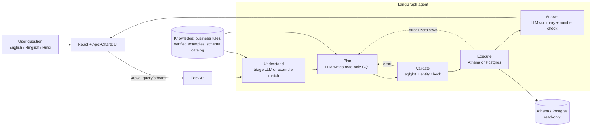

# GMR DISCOM Chatbot

Ask plain-English (or Hinglish / Hindi) questions about GMR's smart-meter programme and get
answers computed live from the data lake — KPI cards, dashboard-style charts, tables and a
written summary.

- **WFM** (work-force management): installations, SAT, stock, revenue and receivables, O&M
  complaints, technician productivity, meter journey. Data: Athena (silver tables) and the
  WFM Postgres database (`public.gold_*` tables). One query only ever uses one engine.
- **MDM**: only the meter-to-feeder auto-indexing tables in Athena. Other meter data is declined.

Every answer is written by an LLM from the real query result; every number is checked in code
against that result before it is shown.

## Tech stack

| Layer | Technologies |
|---|---|
| Backend | Python 3.11+, FastAPI, LangGraph / LangChain-core, sqlglot, pandas, boto3 (Athena), psycopg2 (Postgres), fastembed + BM25 retrieval, rapidfuzz |
| LLMs | Free-tier OpenAI-compatible providers (Groq, NVIDIA NIM, Gemini) with per-stage model chains and automatic fallback |
| Data | AWS Athena (silver tables) and PostgreSQL (`public.gold_*` tables), read-only |
| Optional | Redis for session cache, answer cache and per-session rate limiting (the app runs without it) |
| Frontend | React 19, TypeScript, Vite, ApexCharts |
| Packaging | Docker and docker-compose for both services |

## Architecture



See [EXPLANATION.md](EXPLANATION.md) for the reasoning behind each stage and the safety guards.

## Key design points

- **The LLM never touches the database directly.** It proposes SQL; application code validates it (single `SELECT`, known tables and columns, one engine), and the connectors are read-only as a second layer.
- **Answers are grounded.** Every number in the written summary is checked against the query result, and superlative claims ("highest", "lowest") are re-checked against the rows.
- **Bounded loops.** Step, repair, query and token limits stop runaway agent behaviour; the LLM cannot extend them.
- **Domain knowledge lives in YAML, not prompts.** KPI rules, verified question-to-SQL examples, table metadata and chart types are editable without code changes.

---

## Repository layout

```
.
├── backend/                     FastAPI service (Python)
│   ├── gmr_agents/              the chatbot
│   │   ├── main.py              API: /api/ai-query (+ /stream), sessions, table paging, TTS, history, metrics
│   │   ├── llm_pipeline.py      understand → write SQL → run → answer (stages + prompts)
│   │   ├── graph/               LangGraph orchestration of those stages (nodes, routing, state)
│   │   ├── guards/              step / retry limits, prompt-injection scan, SQL validation, idempotency
│   │   ├── validation/          SQL safety (sqlglot), entity check, number check, grounding, scope
│   │   ├── tools/               tools the planner may call (SQL executor, calculator)
│   │   ├── sql/                 query execution, engine connections, place hierarchy
│   │   ├── schema/              live table catalog, retrieval (BM25 + embeddings), knowledge store
│   │   │   └── data/            business_rules / examples / kpi_definitions / table_metadata / charts (.yaml)
│   │   ├── answer_cache.py      answer cache keyed by data version
│   │   ├── context_manager.py   prompt token budgeting
│   │   ├── metrics.py           latency / token / refusal metrics for /api/metrics
│   │   └── prewarm.py           optional cache pre-warmer (PREWARM_ENABLED)
│   ├── shared/                  config (.env), LLM gateway + rate limiter, token counting,
│   │                            logging, chat-session store, TTS, number formatting
│   ├── db_connection/           read-only Athena (boto3) and Postgres (psycopg2) connectors
│   ├── tests/                   unit tests + graph scenario test (no LLM / DB needed)
│   ├── eval/question_bank/      question bank + tools that run it against the live API
│   ├── requirements.txt
│   ├── run_backend.ps1          start script (Windows)
│   └── Dockerfile, docker-compose.yml
└── frontend/                    React 19 + TypeScript + Vite single-page app
    ├── src/
    │   ├── api/client.ts        backend API client (streaming answers, sessions, TTS)
    │   ├── components/          chat workspace, KPI cards, ApexCharts charts, tables
    │   ├── styles/, utils/
    │   └── main.tsx, App.tsx
    ├── scripts/verify-charts.mjs  regression check for chart options
    └── Dockerfile, docker-compose.yml
```

Generated at runtime and git-ignored: `backend/outputs/` (logs, chat sessions, caches, the
embedding model, `knowledge.json`), `backend/gmr_agents/cache/` (table catalog cache),
`backend/eval/question_bank/results/`.

---

## How a question is answered

```
question
  │
  ▼
1. UNDERSTAND   near-exact match to a verified example → routed by code (no LLM call)
                otherwise the triage LLM: kind (data | explain | chitchat | out_of_scope),
                standalone question (follow-up resolved, translated), topics, tables
  │
  ▼
2. PLAN         prompt = topic rules (business_rules.yaml) + retrieved verified examples
                + compact schema of the chosen tables → one read-only SQL + how to present it
   VALIDATE     sqlglot safety check (single SELECT, known tables/columns, one engine)
                + entity check (places / categories / years asked must be in the filters)
   EXECUTE      SQL runs as written (Athena or Postgres), read-only at the connector too
   REPAIR       on rejection, DB error or zero rows: the exact error goes back to the LLM
                (max LLM_MAX_REPAIRS); step / query / token caps stop runaway loops
  │
  ▼
3. ANSWER       summary, insights and follow-ups written from the result rows;
                every number is checked against the rows in code
```

`explain` questions are answered from retrieved KPI definitions; `chitchat` / `out_of_scope`
replies come from the triage call.

**Models.** Free-tier OpenAI-compatible providers (Groq, NVIDIA NIM, Gemini). Each stage has
its own ordered model chain (`LLM_MODELS_TRIAGE / _SQL / _ANSWER / _EXPLAIN` in `.env`); the
gateway (`shared/llm_gateway.py`) sends each call to the first model with free budget and
moves down the chain on any failure. All calls pass one sliding-window rate limiter.

---

## Running locally

Prerequisites: Python 3.11+, Node.js 18+, AWS credentials for Athena, and network access to
the WFM Postgres (VPN). Redis is optional: leave `REDIS_HOST` blank (or let it be unreachable) and the
app falls back to local, in-process stores.

> **Data access:** the chatbot queries a private data lake, so it cannot be run end to end without
> your own Athena/Postgres credentials and tables. The unit tests and the graph scenario test run
> without any LLM or database.

### Backend

```powershell
cd backend
python -m venv .venv
.venv\Scripts\pip install -r requirements.txt
# create backend\.env with every setting listed in shared/config.py and db_connection/config.py
.\run_backend.ps1            # http://127.0.0.1:8000   (-Dev for auto-reload)
```

`.env` is never committed. `shared/config.py` refuses to start if a setting is missing — the
error lists the missing names. Required groups: AWS / Glue / Postgres connection, LLM provider
keys and model chains, retrieval and cache settings.

Check it: `curl http://127.0.0.1:8000/api/health` lists the tables the chatbot can query.

### Frontend

```powershell
cd frontend
npm install
npm run dev                  # http://localhost:5173 — proxies /api to the backend
```

Optional frontend settings (`.env.local`): `VITE_API_HOST`, `VITE_API_PORT` (dev proxy
target), `VITE_API_BASE` (backend URL baked into a production build).

### Docker

`backend/docker-compose.yml` and `frontend/docker-compose.yml` build each service; both join
the external `app-network`. The backend reads `backend/.env` at runtime; set `VITE_API_BASE`
in the frontend compose file to the backend's public URL.

---

## API

| Method | Path | Purpose |
|---|---|---|
| POST | `/api/ai-query` | answer a question (`{"question", "session_id"}`) |
| POST | `/api/ai-query/stream` | same, streamed (status → numbers → text) |
| POST | `/api/table-page` | next page of a result table |
| GET/POST/PATCH/DELETE | `/api/sessions[/{id}]` | chat sessions |
| GET | `/api/datasets` | tables the chatbot can query |
| POST | `/api/text-to-speech` | audio for the answer's Play button |
| GET | `/api/health` | status + loaded tables |
| GET | `/api/history[/{trace_id}]` | question log / one question's full trace |
| GET | `/api/llm/status` | each model's live free-tier budget |
| GET | `/api/metrics` | P50/P95 latency, tokens, cost, refusal / repair rates vs SLOs |
| GET | `/api/cache/status` | answer-cache version + pre-warmer state |

---

## Changing behaviour

| To change | Edit |
|---|---|
| How a KPI is computed / a new KPI | `gmr_agents/schema/data/business_rules.yaml` (reloads without restart) |
| A verified question → SQL example | `gmr_agents/schema/data/examples.yaml` (check with `eval/question_bank/verify_examples.py`) |
| Column meaning, table description, which tables load | `gmr_agents/schema/data/table_metadata.yaml` |
| KPI reference used for explain answers | `gmr_agents/schema/data/kpi_definitions.yaml` |
| Chart types and when each fits | `gmr_agents/schema/data/charts.yaml` |
| Models, limits, budgets, cache sizes | `backend/.env` |

After changing which tables load, move `gmr_agents/cache/<domain>_catalog.json` aside and
restart so the catalog is rebuilt.

---

## Tests and evaluation

```powershell
cd backend
.venv\Scripts\python -m unittest discover -s tests     # unit tests, no LLM / DB
.venv\Scripts\python tests\test_agent_graph.py          # graph scenarios with a fake LLM

cd ..\frontend
npm run verify:charts                                   # chart option regression check
npm run build                                           # type check + production build
```

Question bank (needs the backend running; uses real LLM quota):

| Script (`backend/eval/question_bank/`) | Does |
|---|---|
| `run_bank.py --ids <set>` | asks questions (sets in `id_sets.yaml`) and records every answer to `results/` |
| `show.py <run>` | compact review of a results file |
| `grade_kpi.py <run>` | grades a KPI-card run: answered, right kind, right gold table, rows |
| `eval_followups.py` | replays real follow-up failures (resolved against the wrong turn) |
| `verify_examples.py` | runs every SQL in `examples.yaml` through the safety check and the DB |
| `run_charts.py` | one question per chart type; reports the chart drawn |
| `model_bench.py` | benchmarks free-tier models per stage on real prompts |

---

## Logs

- `outputs/logs/backend.log` — server log, rotated daily
- `outputs/logs/questions.jsonl` — one record per question: resolved question, SQL, rows,
  models, tokens, timings per step
- `outputs/logs/llm_calls.jsonl` — one record per LLM call
- `outputs/gmr_chat_sessions.json` — chat sessions

---

## Results and evaluation

The repository includes an evaluation harness (`backend/eval/question_bank/`, described above): a question bank, a KPI grader, a follow-up replay, an example verifier and a per-stage model benchmark. Run outputs are written to `backend/eval/question_bank/results/`, which is git-ignored, so **no benchmark numbers are published in this repository**.

_TODO: run `run_bank.py` and `grade_kpi.py` against a deployment and record the answered rate, correct-table rate, latency (P50/P95 from `/api/metrics`) and refusal/repair rates here._

## Screenshots

_TODO: add a screenshot or short GIF of a question producing KPI cards, a chart, a table and the written summary (for example under `docs/screenshots/`)._

## Further reading

- [EXPLANATION.md](EXPLANATION.md) — how the agent works and why it is built this way
