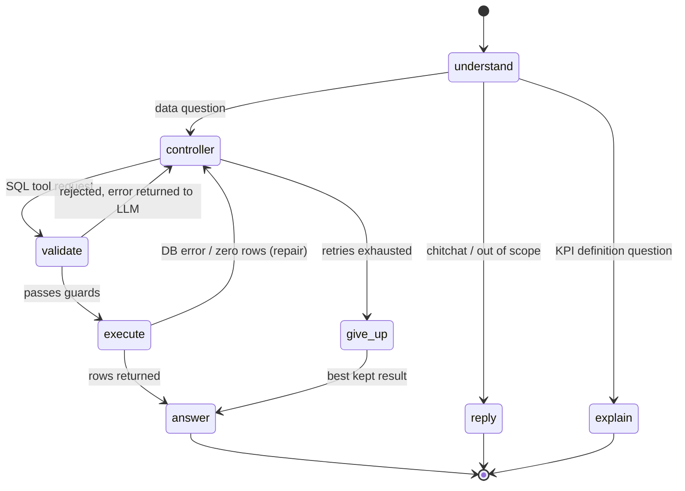

# How the GMR DISCOM Chatbot Works

This document explains the design of the chatbot: the problem, the agent workflow, the safety layers and the main trade-offs. Setup and API details are in [README.md](../README.md).

## 1. The problem

Operations and management teams in a smart-meter programme need numbers (installations, stock, receivables, complaints, technician productivity) that live in a data lake and a Postgres database. Writing SQL for each question is slow and error-prone. The chatbot lets a user ask in plain English, Hinglish or Hindi and returns KPI cards, charts, a table and a written summary computed from live data.

The hard part is not generating SQL. It is making sure the answer is **correct, read-only and verifiable**, so users can trust the numbers.

## 2. Scope

| Domain | Data | Notes |
|---|---|---|
| WFM (work-force management) | Athena silver tables and Postgres `public.gold_*` tables | One query only ever uses one engine |
| MDM | Meter-to-feeder auto-indexing tables in Athena | Other meter data is declined as out of scope |

## 3. The agent workflow

The workflow is a **LangGraph** state graph (`backend/gmr_agents/graph/`). The principle is: *the LLM plans and writes; application code validates, executes and decides when to stop.*

| Node | Who acts | Job |
|---|---|---|
| `understand` | Triage LLM, or a no-LLM router when the question closely matches a verified example | Classify the question (data / explain / chitchat / out of scope), resolve follow-ups into a standalone question, pick topics and tables |
| `controller` | LLM | Write one read-only SQL query and how to present it, using business rules, retrieved verified examples and a compact schema of the chosen tables |
| `validate` | Code | Tool allowlist, SQL safety check, entity check, idempotency check |
| `execute` | Code | Run the SQL on Athena or Postgres through read-only connectors |
| `answer` | LLM + code | Write the summary, insights and follow-ups from the result rows, then check every number |
| `explain` | LLM | Answer KPI definition questions from the knowledge files (no SQL) |
| `give_up` / `step_limit` | Code | Return the best kept result or an honest refusal when limits are reached |

## 4. Safety and correctness layers

1. **SQL guard** (`validation/sql_guard.py`, `sqlglot`): exactly one `SELECT`; no writes or DDL; no `SELECT *`; every output column aliased; only catalogued tables and columns; never mixing Athena and Postgres tables.
2. **Entity check** (`validation/entity_check.py`): if the question names a place, category, year or top-N, the SQL's filters must reflect it. This catches the common error of a query that silently ignores a filter.
3. **Read-only connectors** (`db_connection/`): the database session is read-only, independent of the guards.
4. **Prompt-injection signals** (`guards/injection.py`): treated as a signal, not the only defence. Tools come only from an allowlist and untrusted data is wrapped.
5. **Loop limits** (`guards/limits.py`): maximum steps, repairs, queries and tokens, enforced by routing code with LangGraph's recursion limit as a backstop.
6. **Idempotency** (`guards/idempotency.py`): the same query with the same context is not executed twice.
7. **Number check** (`validation/number_check.py`): each figure in the written answer must be found in the result, after rounding or lakh conversion.
8. **Extreme check** (`validation/extreme_check.py`): claims such as "highest" or "lowest" are verified against the rows.
9. **Grounding** (`validation/grounding.py`): KPI explanations must cite retrieved evidence, or the bot abstains.

## 5. Knowledge and retrieval

Business knowledge is stored as YAML in `backend/gmr_agents/schema/data/`:

- `business_rules.yaml` — how each KPI is computed (hot-reloaded)
- `examples.yaml` — verified question → SQL examples, checked by `eval/question_bank/verify_examples.py`
- `table_metadata.yaml` — which tables load, column hints, table descriptions
- `kpi_definitions.yaml` — reference text for "explain" questions
- `charts.yaml` — chart types and when each fits

Retrieval combines BM25 and local embeddings (`fastembed`), with `rapidfuzz` for typo correction and near-exact question matching. A compact schema "brief" is built per question so prompts stay small, and a token-budget manager (`context_manager.py`) trims context.

## 6. Models

The system uses free-tier, OpenAI-compatible providers (Groq, NVIDIA NIM, Gemini). Each stage (triage, SQL, answer, explain) has its own ordered model chain set in `.env`. The gateway sends each call to the first model with remaining free budget and falls through the chain on failure, under one sliding-window rate limiter. `eval/question_bank/model_bench.py` benchmarks models per stage.

## 7. Caching, sessions and metrics

- Answers are cached keyed by data version (`answer_cache.py`); an optional pre-warmer fills the cache.
- Chat sessions are stored locally and optionally mirrored to Redis, which is explicitly not a single point of failure: when Redis is blank or down, the app falls back to local stores.
- `/api/metrics` reports latency percentiles, tokens, refusal and repair rates; `/api/llm/status` shows each model's remaining budget; logs record each question's SQL, rows, models, tokens and step timings.

## 8. Frontend

A React 19 + TypeScript + Vite single-page app. It streams the answer (status, then numbers, then text), renders KPI cards, ApexCharts visualisations, paged tables and suggested follow-ups, and supports a "play" button for text-to-speech.

## 9. Testing and evaluation

- Unit tests (`backend/tests/`) cover chunking, token budgets, hybrid retrieval, number and extreme checks, grounding, security, rate limiting, hierarchy resolution and tool calling, and run without an LLM or database.
- `test_agent_graph.py` exercises graph scenarios with a fake LLM.
- `frontend` has `npm run verify:charts` and a type-checked production build.
- The question-bank tools measure answers against the live API. No benchmark figures are committed (results are git-ignored); see the Results section of the README.

## 10. Limitations and trade-offs

- The agent depends on free-tier LLM quotas, so latency and availability vary with provider limits.
- Answers are only as good as the verified examples and business rules; new KPIs need an entry in `business_rules.yaml` (and ideally `examples.yaml`).
- The system needs access to the private data lake, so a public demo requires a sanitised dataset.
- The current setup scripts target Windows (PowerShell); Docker files are provided for other platforms.
